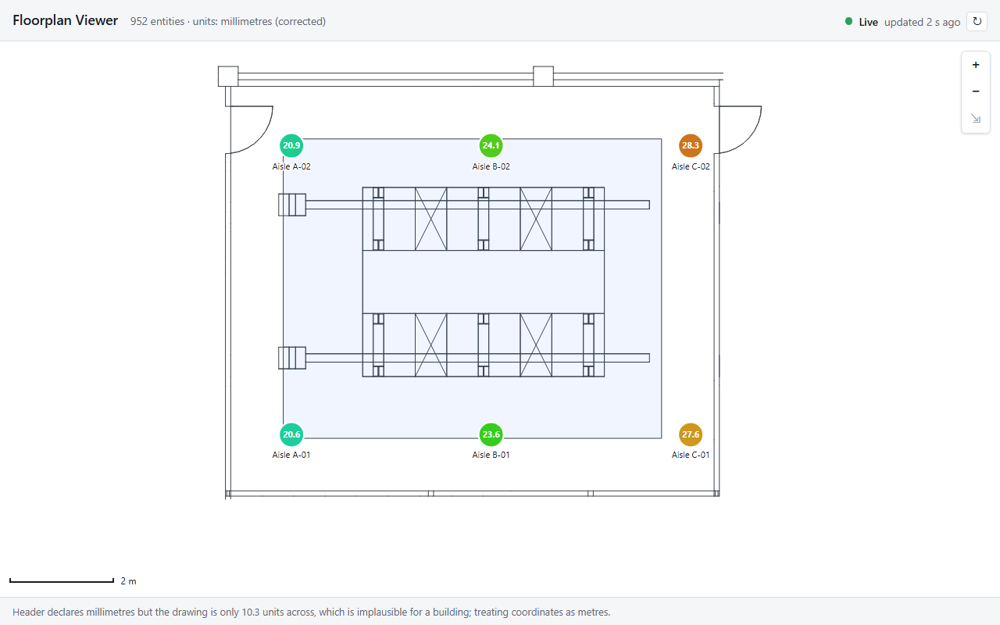

# Data Centre Floorplan Viewer

OctaiPipe frontend take-home, Assessment 1 (DXF Viewer).

A React + TypeScript app that renders a data-hall floorplan from a DXF file, lets you pan and zoom around it, and overlays live sensor readings at their physical positions. Readings are polled from a mocked API every 5 seconds; the UI makes it obvious when they are live, stale or missing.



## Running it

Requires Node 20.19 or newer (22.12+ recommended), which is what Vite 8 supports.

```bash
npm install
npm run dev        # http://localhost:5173
npm test           # unit + component tests (Vitest, jsdom)
npm run build      # type-check and production build into dist/
npm run preview    # serve dist/
npm run lint       # oxlint
npm run typecheck  # tsc -b
npm run format     # prettier
```

The floorplan (`public/floorplan.dxf`) and sensor feed (`public/sensors.json`) are fetched at runtime rather than imported, so the loading and failure paths are real.

## What it does

| Brief                                                                    | Where                                                                                                                                     |
| ------------------------------------------------------------------------ | ----------------------------------------------------------------------------------------------------------------------------------------- |
| Renders the floorplan from the DXF                                       | `src/dxf/` parses and normalises it, `src/viewer/FloorplanLayer.tsx` draws it as SVG paths                                                |
| Pan and zoom                                                             | `src/viewer/usePanZoom.ts`: drag, wheel about the cursor, double-click, `+` `-` `0` and arrow keys, toolbar, fit-to-view                  |
| Sensors overlaid at their model-space positions with current temperature | `src/overlays/sensors/SensorLayer.tsx`                                                                                                    |
| Detail on interaction                                                    | hover or focus shows a tooltip; click or Enter pins a detail card with label, temperature, humidity, reading time and position            |
| Live data from a polled API                                              | `src/sensors/`: a `SensorApi` interface, a mock that walks the recorded series, and `usePolledReadings` with live, stale and error states |

Also there: a scale bar, a status bar with the age of the last successful poll, polling paused in hidden tabs, retry buttons on every failure, and a footer listing anything the DXF normaliser had to skip or guess.

## Architecture

```
src/
  geometry/   Pure maths. Viewport, modelToScreen/screenToModel, zoomAt, fitBounds, bounds.
  dxf/        DXF -> Drawing. Parser wrapper, normaliser, unit heuristic, SVG path data.
  viewer/     The map surface. Viewport state, gestures, controls, scale bar, overlay context.
  overlays/   Things drawn on top of the map. Currently only sensors.
  sensors/    Sensor domain and data. Types, SensorApi interface, mock, validator, polling hook.
  ui/         App-level chrome (status bar).
  lib/        Small generic hooks and helpers (async load, relative time, visibility).
  App.tsx     Composes the above. main.tsx is the composition root that builds the SensorApi.
```

The dependency direction is one way: `geometry` knows nothing; `dxf` and `sensors` depend on `geometry`; `viewer` depends on `geometry` and `dxf`; `overlays` depend on `viewer` and `sensors`; `App` depends on everything. Nothing below `App` knows where readings come from.

### Coordinate space

There are exactly two spaces and one mapping between them.

- Model space: the floorplan's own coordinates in millimetres, Y up (CAD convention). DXF geometry and `sensors.json` positions both live here.
- Screen space: CSS pixels relative to the viewer element, Y down.

The mapping is a `Viewport` of three numbers, `{ scale, tx, ty }`, and two pure functions in `src/geometry/viewport.ts`:

```
screen.x =  model.x * scale + tx
screen.y = -model.y * scale + ty
```

Everything that draws uses this one mapping:

- The floorplan is drawn in model coordinates inside a single `<g transform="matrix(s 0 0 -s tx ty)">`. Pan and zoom change one attribute; path data is computed once per drawing. Strokes use `vector-effect: non-scaling-stroke` so line weight is constant at any zoom.
- Overlays draw in screen space. They read the live viewport from context with `useViewport()` and convert their model positions with `modelToScreen`. Markers therefore stay a constant size and keep crisp text, and the alignment with the floorplan is guaranteed because both derive from the same `Viewport`.

`zoomAt` keeps the model point under the cursor fixed, clamps to limits, and returns the same object when nothing changes. `fitBounds` is degenerate-safe: empty bounds, a zero-size viewer or a single point all produce a finite viewport.

Tests cover the Y flip direction, round trips, cursor-fixed zoom in and out, the SVG matrix agreeing with `modelToScreen`, and, in `SensorLayer.test.tsx`, that every marker coincides with the floorplan transform before and after a pan and a wheel zoom.

### The DXF, and what was untidy about it

The brief says the file is "not perfectly tidy". Findings, all handled in `src/dxf/normalise.ts` and reported in the UI footer rather than silently fixed:

| Finding                                                                                                                                                                    | Handling                                                                                                                                                                                                                                                                                                                                                                                           |
| -------------------------------------------------------------------------------------------------------------------------------------------------------------------------- | -------------------------------------------------------------------------------------------------------------------------------------------------------------------------------------------------------------------------------------------------------------------------------------------------------------------------------------------------------------------------------------------------- |
| The header declares millimetres (`$INSUNITS = 4`) but the geometry spans x 3.8 to 14.1, y -3.5 to 4.7. That is metres. `sensors.json` is in millimetres (x 5200 to 12800). | `resolveUnitScale` treats the header as a claim and checks it against the drawing extent. An extent under 1 m or over 2 km is implausible for a building, so it tries metres, millimetres, centimetres, inches and feet in that order and picks the first plausible one. Here that scales the drawing by 1000. The decision and reason are shown in the footer. An explicit override is available. |
| DXF is Y-up, the screen is Y-down.                                                                                                                                         | Flipped once, in the viewport matrix.                                                                                                                                                                                                                                                                                                                                                              |
| The ENTITIES section holds 849 LINEs and 102 ARCs on layer `0`, plus one closed LWPOLYLINE on layer `h01_z01`.                                                             | Lines, arcs, circles and polylines are supported. Closed polylines are tinted as zones.                                                                                                                                                                                                                                                                                                            |
| The BLOCKS section holds about 3,500 entities, but there are zero INSERT references.                                                                                       | Blocks are ignored. An INSERT, if one appeared, is reported as skipped rather than dropped silently.                                                                                                                                                                                                                                                                                               |
| 96 arcs have a 5 mm radius (hinge detail); 6 have a 0.9 m radius (door swings).                                                                                            | Non-scaling strokes keep both visible.                                                                                                                                                                                                                                                                                                                                                             |
| The aisle C sensors (x = 12800) sit outside the `h01_z01` polyline, which ends near x = 12245, but inside the drawing.                                                     | The zone is a sub-area, not the hall boundary. Found by a test that assumed otherwise and failed.                                                                                                                                                                                                                                                                                                  |
| Polyline bulges (arc segments) are not present in this file.                                                                                                               | If they were, they would be flattened to straight edges and counted in the warnings.                                                                                                                                                                                                                                                                                                               |

Arcs are emitted as SVG arc commands in model space. Because the floorplan group applies a reflection, a counter-clockwise DXF arc keeps `sweep-flag = 1` and renders the right way round. This is covered by tests with explicit expected path strings.

### Data layer and the update cycle

`SensorApi` is the only thing the UI depends on:

```ts
interface SensorApi {
  listSensors(signal?: AbortSignal): Promise<readonly Sensor[]>
  getLatestReadings(signal?: AbortSignal): Promise<ReadingsSnapshot>
}
```

`Sensor` is static placement data (id, label, position). `Reading` is what changes. The overlay joins the two by id at render time, so a sensor with no reading yet still appears, marked "no data".

`createMockSensorApi` implements the interface over `sensors.json`. Each poll answers with the next reading of every sensor, with randomised latency and a failure injected every 7th call (`MOCK_FAIL_EVERY` in `src/config.ts`) so the stale state is visible in a demo. When a series runs out it wraps around: the file holds 30 seconds of data per sensor and a feed that stopped after six polls would hide the behaviour this app exists to show.

`usePolledReadings` drives it:

- A `setTimeout` chain, not `setInterval`. The next poll is armed only after the previous one settles, so a slow response never overlaps the next request.
- Four explicit states. `loading` before the first result, `live` after a success, `stale` when the latest poll failed but an earlier snapshot is still shown, `error` when there is nothing to show.
- The last good snapshot is kept across failures. An operator wants the last known values, clearly flagged, not a blank map.
- Pause via `enabled` (used when the tab is hidden) and `refresh()` for an immediate poll. Aborts on unmount.

The status bar reports the state, the age of the last successful poll, the failure reason, and offers a refresh.

### Adding another overlay

An overlay is a component rendered as a child of `FloorplanViewer`. It takes its own data as props and reads the mapping from context:

```tsx
function CracUnitsLayer({ units }: { units: readonly CracUnit[] }) {
  const { viewport } = useViewport()
  return (
    <g>
      {units.map((unit) => {
        const { x, y } = modelToScreen(unit.position, viewport)
        return <rect key={unit.id} x={x - 8} y={y - 8} width={16} height={16} />
      })}
    </g>
  )
}

<FloorplanViewer drawing={drawing}>
  <SensorLayer ... />
  <CracUnitsLayer units={units} />
</FloorplanViewer>
```

Nothing in the viewer or the sensor layer changes. `SensorLayer.tsx` is the worked example.

### Swapping the transport

Implement `SensorApi` over a real endpoint and construct it in `main.tsx` instead of the mock. `App` takes the API as a prop and the tests already exercise it with a scripted implementation.

## Decisions and trade-offs

- **dxf-parser plus my own normaliser**, not a drop-in viewer. `dxf-viewer` brings three.js and owns the camera; placing sensors accurately would mean fighting it. The coordinate space is the thing being assessed, so the app owns it. The parser is wrapped in one file so it can be swapped.
- **Hand-rolled pan and zoom**, not d3-zoom. About 150 lines, with a pure `zoomAt` that is unit-tested. d3-zoom would hide the maths and be harder to extend in a live session.
- **Hand-rolled polling**, not TanStack Query. The update cycle, stale handling and overlap avoidance are what the brief asks to see; a library would hide them behind options.
- **SVG, not canvas.** Under a thousand entities and six markers. SVG gives free hit-testing, accessibility roles and CSS, and one `<path>` per layer keeps the DOM small. Canvas would be the move at tens of thousands of entities.
- **Floorplan in a transformed group, overlays in screen space.** Markers inside the flipped group would render mirrored text and scale with zoom. The cost is one `modelToScreen` call per marker per frame, which is nothing.
- **Pointer capture only after a 4 px drag threshold.** Capturing on pointer down would retarget the click to the viewer and markers would never receive it.
- **Derived state over effects.** The viewport is a pure fit until the user interacts; the load state is derived from a settled result tagged with its request. No `setState` inside effects, no reset dance when the drawing changes, and stale responses are ignored for free.
- **Dependency injection at the root.** `main.tsx` is the only file that knows readings come from a mocked JSON file.
- **Runtime validation of `sensors.json`** with path-qualified errors (`[2].readings[0].temperatureC must be a finite number`). Hand-written because the shape is tiny; a schema library would be the choice if it grew.

## Tests

116 tests across 17 files. They target the three things the brief names and little else.

| Area                       | What is proved                                                                                                                                                                                                                                |
| -------------------------- | --------------------------------------------------------------------------------------------------------------------------------------------------------------------------------------------------------------------------------------------- |
| Model-to-screen            | Y flip direction, round trips with real sensor coordinates, cursor-fixed zoom in and out, zoom then inverse zoom is stable, clamping, fit keeps every corner inside the padding and centres the content, SVG matrix agrees with the function. |
| Markers under pan and zoom | Every marker coincides with the floorplan group's own transform matrix before and after a drag and a wheel zoom, through the real viewer component.                                                                                           |
| DXF handling               | Unit heuristic cases, arc, circle and polyline path strings, arc bounds through axis extremes, normaliser warnings for skipped and flattened entities, and the real `floorplan.dxf` (952 entities, metres corrected, zone geometry).          |
| Polling                    | First poll, interval advance, failure keeps the snapshot and reports stale then recovers, first-poll error, no overlapping requests, unmount, pause and resume, refresh. Fake timers throughout.                                              |
| Mock API                   | One reading per poll, wrap-around, shared source load with retry, every-Nth failure, latency timing, abort.                                                                                                                                   |
| User interaction           | Hover shows the tooltip with label, temperature and humidity; click pins the detail card; close removes it. Also drag pans by the exact delta, a sub-threshold press does not pan, a marker click does not pan, toolbar and keyboard fit.     |
| States                     | Status bar wording for live, stale, offline and paused; app-level floorplan error, sensor-list error with retry recovering, readings offline.                                                                                                 |

Run with `npm test`.

## How I used AI assistants

I worked with Claude Code throughout, in a plan-first, step-by-step loop. The plan came first: read both briefs, inspect the DXF with shell tools (that is how the units mismatch and the orphaned blocks were found before any code existed), decide the architecture and the time boxes. Then each step was drafted with the assistant, reviewed in the editor, run through typecheck, lint and tests, verified in a headless browser screenshot of the production build, and committed as one commit. The git history is that sequence.

Things the assistant produced that I rejected or reworked:

- First drafts of the drawing hook and the viewer called `setState` synchronously inside `useEffect` to set loading and to refit on resize. The linter flagged it. Both were reworked to derive state instead; the result has fewer renders and no reset logic.
- The first generic async-load hook took a dependency list and spread it into the effect, silenced with a lint directive. Removing the directive showed the rule had been suppressed. It now takes a memoised loader as its single dependency.
- `refresh()` on the polling hook initially bumped a counter the effect did not depend on, so it did nothing. The hook's own test caught it. The fix also removed a redundant generation ref, since the `AbortController` already guards late responses.
- React's synthetic `onWheel` is passive, so the page scrolled while zooming. Reworked to a native non-passive listener.
- A `useCallback` reading `ref.current` tripped the React Compiler lint. Replaced with a plain helper that takes the element from the event.
- The context file mixed a component with a hook, which breaks Fast Refresh. Split into `ViewportContext.ts` and `ViewportProvider.tsx`; the scale-bar maths moved to its own module for the same reason and became trivially testable.
- A test asserted every sensor lies inside the zone polyline. It failed because aisle C does not. The finding was kept and the assumption fixed.
- The app originally constructed the mock API itself. Moved to `main.tsx` and injected, which is what made the app testable with a scripted API.
- Rendering markers inside the flipped floorplan group was considered for its zero extra maths and rejected for mirrored text and zoom-scaled markers.

Decisions made deliberately before code was written, rather than accepted from a draft: the `setTimeout` chain, keeping the last snapshot and flagging it stale, capturing the pointer only after the drag threshold, and specifying the marker alignment test before the overlay components existed.

## Scope cuts

- No layer toggles or minimap. The layers exist in the `Drawing` model, so a toggle is a filter on `drawing.layers` and a checkbox.
- No touch pinch-zoom. Mouse and trackpad wheel only; single-finger drag works through pointer events.
- Block definitions are ignored, because nothing references them. INSERT support would mean applying each block's base point, scale and rotation to its entities.
- Polyline bulges are flattened. None exist in this file.
- No per-sensor history. The data is there (the mock keeps the series) but the UI shows only the latest reading.
- No real transport. The interface is there; the implementation is a mock.
- Styling is deliberately plain. The brief asked for interaction quality over polish.

## What I would do next

1. **Threshold alerting.** Colour is informative but not actionable. Add configurable warning and critical bands, change marker shape (not just colour) when breached, and list breaches in the status bar.
2. **A sparkline in the detail card** from the readings the polling hook has already seen, with a ring buffer per sensor.
3. **Layer panel** with per-layer visibility and the entity counts the normaliser already computes.
4. **INSERT and bulge support** in the normaliser, with tests against a second, messier DXF. The warnings list already tells you when you need it.
5. **Spatial join to zones.** The zone polyline is parsed; a point-in-polygon check would let the app report which zone each sensor is in and aggregate per zone.
6. **Transport.** A `FetchSensorApi` against a real endpoint, plus `ETag` handling so unchanged polls are cheap, and WebSocket push behind the same interface.
7. **Viewport constraints** so the drawing cannot be panned entirely off-screen, and a URL-encoded viewport for shareable views.
8. **Pinch and touch** gestures, and `ResizeObserver` debouncing on very frequent resizes.

## Configuration

All tunables are in `src/config.ts`: asset URLs, the 5-second poll interval, the mock failure cadence and the fit padding. Zoom limits are in `src/geometry/viewport.ts`; the temperature colour range is in `src/overlays/sensors/temperatureScale.ts`.
